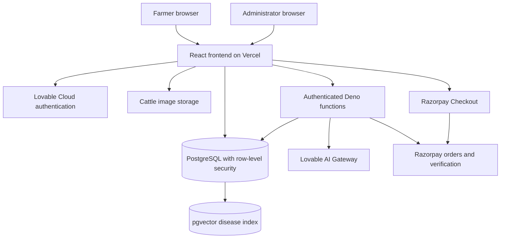
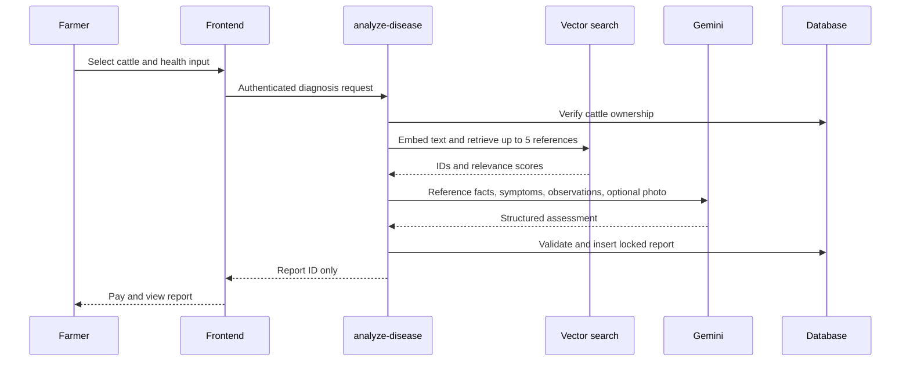

# CattleCare AI

### Multimodal Retrieval-Augmented Generation System for Cattle Disease Diagnosis Using Large Language Models

CattleCare AI is a farmer-focused cattle health application and academic ML project. It combines farmer-selected symptoms, written observations, and optional cattle photographs with a curated disease reference library to produce preliminary AI assessments. Farmers can maintain cattle records, track vaccinations, ask health questions, and access diagnosis reports in English, Hindi, and Marathi.

**Live application:** [cattlecareai.vercel.app](https://cattlecareai.vercel.app/)

> **Medical disclaimer:** This application provides preliminary information, not a confirmed veterinary diagnosis. AI confidence is a model estimate—not measured clinical accuracy. Seek professional veterinary care, especially for severe or critical symptoms. Do not delay urgent care while waiting for AI results or payment processing.

## Contents

- [Project overview](#project-overview)
- [Features and implementation status](#features-and-implementation-status)
- [Technology stack](#technology-stack)
- [System architecture](#system-architecture)
- [Diagnosis and semantic RAG pipeline](#diagnosis-and-semantic-rag-pipeline)
- [Repository structure](#repository-structure)
- [Local development](#local-development)
- [Configuration and secrets](#configuration-and-secrets)
- [Database and storage](#database-and-storage)
- [Authentication and authorization](#authentication-and-authorization)
- [Server function reference](#server-function-reference)
- [Payments](#payments)
- [Languages and reports](#languages-and-reports)
- [Application routes](#application-routes)
- [Testing and validation](#testing-and-validation)
- [Vercel deployment and GitHub updates](#vercel-deployment-and-github-updates)
- [Farmer and administrator workflows](#farmer-and-administrator-workflows)
- [Troubleshooting](#troubleshooting)
- [Limitations and future work](#limitations-and-future-work)
- [Maintenance and contribution guidelines](#maintenance-and-contribution-guidelines)
- [License](#license)

## Project overview

Cattle health information can be difficult to interpret without specialist support. CattleCare AI provides a single place for farmers to record animal details, describe health concerns, receive understandable preliminary guidance, and keep vaccination and diagnosis history.

The current diagnosis engine uses **semantic RAG**, not a trained custom CNN classifier or simple symptom-overlap lookup. It retrieves disease reference records using vector similarity, then supplies the retrieved information and available image to a multimodal language model.

The curated library contains **15 disease records in the reviewed deployment**. This is the size of the reference library, not a fixed limit on the diseases the language model can name. The model may return a disease outside that library; such an answer is marked as model-derived rather than grounded in a matching reference. No clinical accuracy percentage is established by this repository.

## Features and implementation status

| Area | Current implementation | Important qualification |
| --- | --- | --- |
| Farmer accounts | Email/password registration and login, duplicate-email check | Email confirmation and delivery depend on hosted auth settings |
| Mobile authentication | Passwordless six-digit SMS OTP flow alongside email | Real delivery requires an enabled phone provider and configured SMS service; email/password remains available |
| Farmer profile | Name, email display, phone, and location | Updating a contact phone does not prove ownership of that phone; email is read-only on the profile screen |
| Cattle registry | Add and edit cattle details and photographs | Access is scoped to the owner, with authorized admin read access |
| AI diagnosis | Symptoms, observations, optional photo, semantic retrieval, saved report | Preliminary assessment; AI service availability and credits are required |
| Diagnosis reports | Severity, confidence, care guidance, precautions, printing | New farmer reports are payment-locked; older pre-payment reports remain readable |
| Payments | Razorpay Checkout, ₹99 per report, server-side order/capture verification | Connected in test mode; live collection requires live credentials and release checks |
| Chatbot | Streaming cattle-health answers in three languages | Currently uses the model's general knowledge; **does not call the vector retriever** |
| Vaccination records | Vaccine dates, next due date, administrator name, batch number, notes | Due/overdue indicators are in-app; scheduled SMS/email reminders are not implemented |
| Admin dashboard | Diagnosis, signup-profile, and chatbot-question lists; trend charts | Requires a server-verified admin role; each list displays up to 100 recent records |
| Report email | Planned manual summary + report link | Not implemented; blocked on sender-domain/email-service setup |
| Public discovery | Homepage metadata, robots rules, sitemap | Publishing or submitting a sitemap does not guarantee Google indexing |

The application is exclusively farmer-facing. Historical veterinarian-related tables remain in the schema, but veterinarian login, booking, and finder features are not active product features.

## Technology stack

| Layer | Technologies | Purpose |
| --- | --- | --- |
| Frontend | React 18, TypeScript 5, Vite 5 | Client-side application and asset build |
| Navigation | React Router | Public, farmer, and admin routes |
| UI | Tailwind CSS 3, shadcn/ui, Radix UI, Lucide | Shared controls, styles, icons, and accessibility primitives |
| Data fetching | TanStack Query 5 | Query caching and report/admin data fetching |
| Charts | Recharts 2 | Diagnosis trends and most frequent disease assessments |
| Supporting libraries | date-fns, React Markdown, React Hook Form, Zod | Date handling, chatbot rendering, and form/validation tooling |
| Backend | Lovable Cloud | Managed authentication, PostgreSQL database, storage, and server functions |
| Vector retrieval | PostgreSQL pgvector | Disease embeddings and cosine-similarity matching |
| Server runtime | Deno edge functions | Authenticated AI requests, indexing, translation, and payment verification |
| AI access | Lovable AI Gateway | Server-side access to language and embedding models |
| Checkout | Razorpay | India-focused one-time report payments |
| Hosting | Vercel | Static frontend deployment; backend remains on Lovable Cloud |
| Tests | Vitest | Focused security, permission-helper, input, and payment tests |

Model identifiers used by the source:

- Diagnosis: `google/gemini-2.5-flash`
- Disease/query embeddings: `google/gemini-embedding-2`
- Chatbot: `google/gemini-3-flash-preview`
- Dynamic report translation: `google/gemini-2.5-flash-lite`

Provider availability and model behavior may change. Preview models are not an availability guarantee.

## System architecture



- The frontend contains no standalone Node or Python backend.
- Authentication identifies the caller; row-level security controls database access.
- Diagnosis requests use a caller-scoped database client to check cattle ownership and write the report.
- Privileged operations—disease indexing, chatbot audit writes, and payment state changes—use narrowly scoped server-side clients after authentication and relevant authorization checks.
- Vercel builds and serves the frontend only. Moving the frontend does not move the database, users, storage, or deployed functions.

## Diagnosis and semantic RAG pipeline

### 1. Capture and validate input

The farmer selects an owned cattle record and supplies symptoms, observations, a photograph, or a combination. The server verifies the session, validates the request, checks ownership of the selected cattle, and rejects empty health input.

Observations are limited to **2,000 characters**. Uploaded images must be JPEG, PNG, or WebP and no larger than **10 MiB**. Diagnosis image URLs must belong to the caller's cattle-image folder.

### 2. Build the reference index

The admin-only `index-diseases` function combines each disease's name, description, and symptoms into a text record, embeds records in batches of 20, and upserts the resulting vectors with the embedding-model identifier.

Vectors have **3,072 dimensions**. The database stores full-dimensional vectors and uses an HNSW index over half-precision vector casts for cosine search. Re-index disease records after changing their source content. Do not mix vectors generated by different embedding models without a deliberate migration and complete re-index.

### 3. Retrieve relevant diseases

The diagnosis function joins selected symptoms and written observations into a query and embeds it using the same model. `match_diseases` returns the closest disease IDs and similarity scores, bounded to a maximum of **five** results. The function then reads those disease records and constructs the model context.

For query vector `q` and reference vector `d`, the retrieval relevance is based on:

```text
cosine_similarity(q, d) = dot(q, d) / (norm(q) × norm(d))
cosine_distance(q, d)   = 1 - cosine_similarity(q, d)
```

For an image-only request, retrieval currently uses a generic cattle-visible-symptom text query. The photograph is examined during generation; it is **not embedded into the vector search**.

### 4. Generate and validate the assessment

Gemini receives the retrieved reference facts, farmer input, and optional photograph. The prompt requests structured JSON containing a disease name, model confidence, severity, veterinary recommendation, urgency, treatment duration, description, first aid, home remedies, and precautions.

The server validates important output fields and advice arrays. It checks the predicted disease name against retrieved names to assign database/model provenance and forces veterinary recommendation for severe or critical assessments.

**Retrieval similarity and diagnosis confidence are different values.** Similarity measures reference relevance; confidence is the language model's own estimate. There is no implemented calibration model or clinical evaluation establishing confidence reliability.

### 5. Save a locked report

A UUID is assigned before insertion. The report is saved with diagnosis details and treatment notes, but the client receives only `{ "report_id": "..." }`. New reports start locked, preventing the farmer from retrieving paid content before verification. The farmer is redirected to the report payment screen.



## Repository structure

```text
.
├── src/
│   ├── assets/                    # Cattle disease images
│   ├── components/
│   │   ├── auth/                  # Mobile OTP form
│   │   ├── ui/                    # Shared shadcn/ui controls
│   │   ├── RequireAuth.tsx        # Signed-in route guard
│   │   ├── RequireAdmin.tsx       # Server-verified admin guard
│   │   └── PayToUnlock.tsx        # Report checkout flow
│   ├── hooks/                     # Toast and mobile helpers
│   ├── integrations/supabase/     # Generated Lovable Cloud client and types
│   ├── lib/                       # i18n, validators, helpers, unit tests
│   ├── pages/                     # Farmer and admin screens
│   ├── App.tsx                    # Providers and application routes
│   ├── index.css                  # Global styles and design tokens
│   └── main.tsx                   # React entry point
├── supabase/
│   ├── functions/
│   │   ├── _shared/               # Auth, validation, embedding, payment helpers
│   │   ├── analyze-disease/
│   │   ├── cattle-chat/
│   │   ├── index-diseases/
│   │   ├── razorpay-payment/
│   │   └── translate-content/
│   ├── migrations/                # Earlier SQL migration history
│   └── config.toml                # Managed function/platform configuration
├── drizzle/
│   ├── schema.ts                  # Schema representation
│   └── migrations/                # Later schema/security/payment migrations
├── public/                        # Favicon, robots.txt, sitemap.xml
├── AGENTS.md                      # Engineering and security rules
├── DEPLOYMENT_READINESS.md         # Prior verification and release caveats
├── roadmap.md                     # Completed work and remaining blockers
├── package.json                   # Dependencies and development commands
├── vite.config.ts                 # Vite settings and source alias
└── vercel.json                    # Frontend deployment, routing, and headers
```

The `supabase` directory name and `VITE_SUPABASE_*` variable names are existing code conventions for the managed backend; they do not mean a separate backend account is required for this deployment.

## Local development

### Prerequisites

- Git and access to this repository.
- Node.js 22 LTS recommended, with npm; Bun can also run the project scripts.
- The project's public backend connection values.
- Access to the configured Lovable Cloud backend. Running Vite alone does not create the database or deploy functions.

### Start the frontend

Clone this repository using the URL shown by GitHub's **Code** button, then open its folder:

```bash
npm install
npm run dev
```

The Vite development server is configured on **http://localhost:8080**. Set the browser environment variables before starting. For a fresh local checkout, a `.env.local` file can contain:

```dotenv
VITE_SUPABASE_URL=<managed-backend-url>
VITE_SUPABASE_PUBLISHABLE_KEY=<public-publishable-key>
VITE_SUPABASE_PROJECT_ID=<project-identifier-if-required-by-tooling>
```

Replace the bracketed placeholders with project configuration values, without angle brackets or surrounding quotes. Obtain them from the project's authorized configuration—not from this README. Do not place private keys in this file.

### Available commands

| Command | Description |
| --- | --- |
| `npm run dev` | Start the local frontend |
| `npm run build` | Generate a production frontend in `dist/` |
| `npm run build:dev` | Build using Vite development mode |
| `npm run preview` | Preview the generated frontend locally |
| `npm run lint` | Run ESLint |
| `npm run test` | Run Vitest once |

Bun equivalents are available, for example `bun install`, `bun run dev`, and `bun run test`. Vercel currently uses `npm install` and `npm run build` as configured in `vercel.json`.

## Configuration and secrets

### Browser configuration

| Variable | Purpose | Security classification |
| --- | --- | --- |
| `VITE_SUPABASE_URL` | Backend connection address | Public client configuration |
| `VITE_SUPABASE_PUBLISHABLE_KEY` | Browser API key used with the caller's session | Public client configuration; not an admin credential |
| `VITE_SUPABASE_PROJECT_ID` | Managed project/tooling identifier | Public identifier where required |

All `VITE_*` values are bundled into the browser application. **Never put AI secrets, Razorpay secrets, database passwords, or privileged server credentials into a `VITE_*` variable.** Public keys do not replace row-level security.

### Server-only configuration

| Secret or managed value | Used for |
| --- | --- |
| `LOVABLE_API_KEY` | AI and connector gateway requests |
| `RAZORPAY_CONNECTION_KEY_ID` | Connected Razorpay account's Checkout key ID |
| `RAZORPAY_CONNECTION_KEY` | Server-only Razorpay connector gateway credential |
| Managed backend runtime credentials | Caller-scoped requests and authorized privileged operations inside functions |

Store private values in Lovable Cloud's server secret configuration. Managed privileged credentials are injected by the platform, are not available for extraction, and must never be copied into GitHub or Vercel. The frontend does not need the Razorpay secret or AI key.

## Database and storage

### Active application tables

| Table | Role | Relationships and access |
| --- | --- | --- |
| `profiles` | Farmer contact details | Profile ID identifies the account; owner and authorized admin reads |
| `user_roles` | Protected role assignments | Server-managed farmer/admin authorization |
| `cattle` | Animal details and image reference | `owner_id` identifies the farmer |
| `reports` | Assessment history, severity, confidence, treatment notes, unlock flag | Associated with cattle and requesting user; farmers read only their unlocked reports |
| `vaccinations` | Vaccine history and next due dates | Associated with cattle; ownership enforced through cattle policies |
| `diseases` | Curated disease names, symptoms, descriptions, guidance | Signed-in reference reads; not a farmer-editable library |
| `disease_embeddings` | Model-tagged 3,072-dimensional semantic index | References a disease; raw table access is revoked from browser roles |
| `chatbot_queries` | Audit of submitted farmer questions and language | Own/admin reads; server-side writes |
| `diagnosis_payments` | Orders, verified payment IDs, fee, status, timestamps | References a report; farmer reads own payments, admin reads permitted records |

Legacy tables such as `appointments`, `conversations`, `messages`, `vet_notes`, and `veterinarians` may still exist. Their existence does not mean retired workflows are supported. The AI chat screen uses `cattle-chat` and logs questions to `chatbot_queries`, not a persistent full conversation history.

### Important database functions

- `is_admin()`: verifies the current caller's protected admin role.
- `admin_metrics(days)`: restricted analytics for 7-, 30-, or 90-day windows. Total cards count all records; charts use the selected window.
- `match_diseases(query_embedding, match_count)`: authenticated search returning disease IDs and similarity only, not raw vectors.
- `my_locked_reports(_report_id)`: returns safe metadata for the caller's unpaid reports, up to 20 entries.
- `email_registered(_email)`: duplicate-email precheck used by registration.

Signup lifecycle logic initializes the profile and assigns a farmer role. Report triggers preserve server-controlled unlock state and ownership rules.

### Cattle photos

The `cattle-images` bucket uses owner-specific folders. Upload, modification, deletion, and listing policies limit access to the owner's folder. **Image object URLs are public and shareable by design**: anyone with a photo link can view that photo. Do not upload sensitive personal documents. Public image URLs are not the same as public report access.

### Migration safety

The repository contains earlier migrations in `supabase/migrations/` and later changes in `drizzle/migrations/`. These are schema history, not evidence that a new empty backend is ready after frontend installation.

Before restoring or creating a separate environment, review both histories, migration ordering, required extensions, signup triggers, grants, policies, reference data, and deployed functions. Apply changes through the project's managed migration workflow. Do not blindly replay both directories against production or run schema-push commands against the shared backend. `drizzle.config.ts` uses a managed migration environment variable; developers should not request or fabricate platform database credentials.

## Authentication and authorization

- Email/password login uses managed authentication.
- Registration normalizes the email and checks for an existing account before signup. This is an email-identity check, not proof that one person cannot create accounts with different email addresses.
- Phone OTP supports passwordless login/signup with number normalization, six-digit code validation, and a 60-second client resend cooldown. Real SMS delivery remains provider-dependent; the client cooldown is not a substitute for server rate limits.
- Signup assigns roles through a protected server trigger. Client metadata must never grant privileges.
- `RequireAuth` protects farmer screens; account changes clear query caches.
- `RequireAdmin` verifies the role through `is_admin()`. Database policies and restricted RPCs remain the actual data-security boundary.
- AI functions validate the caller in code, even where gateway-level JWT verification is disabled.
- Backend policies prevent farmers from accessing another farmer's private records or setting report unlock state.

The duplicate-email precheck reveals whether an address is registered. This deliberate user-experience behavior has account-enumeration privacy implications; review rate limits and abuse controls before wider rollout.

Hosted email confirmation, signup availability, password controls, SMS configuration, and redirect settings must be checked in the actual environment. Source files alone do not verify them. There is no implemented Google/social sign-in or dedicated password-recovery screen in the current UI.

## Server function reference

All application operations below require a signed-in caller. Send an authenticated **POST** request; `OPTIONS` is supported for browser preflight. The frontend normally uses the managed client to attach the session automatically.

| Function | Input body | Result / behavior |
| --- | --- | --- |
| `analyze-disease` | `cattle_id`, `symptoms`, optional `observations`, optional `image_url` | Validates ownership, retrieves references, generates and saves a locked report; returns `report_id` |
| `cattle-chat` | `messages` array of user/assistant entries, `language` (`en`, `hi`, `mr`) | Records the latest question and returns a server-sent event response stream |
| `translate-content` | `texts` array, `targetLanguage` (`en`, `hi`, `mr`) | Returns `{ translated: [...] }`; English can pass through unchanged |
| `index-diseases` | Empty JSON object | Requires admin; embeds and upserts disease records; returns `{ indexed: count }` |
| `razorpay-payment` | `action: "create_order"`, `report_id` | Creates an owned-report order or reports that it is already unlocked |
| `razorpay-payment` | `action: "verify"`, `order_id` | Reads Razorpay payment status and the stored total before unlocking |
| `razorpay-payment` | `action: "check_report"`, `report_id` | Recovers completed payments when the farmer returns |
| `razorpay-webhook` | Razorpay event | Public hint; confirms known orders by reading Razorpay, never by trusting the event |

Example diagnosis body (replace the placeholder UUID with an owned cattle ID):

```json
{
  "cattle_id": "<owned-cattle-uuid>",
  "symptoms": ["fever", "skin_lesions"],
  "observations": "Raised skin lumps and reduced appetite"
}
```

Error responses use an `error` message. Common statuses include `400` for invalid input, `401` for missing/invalid login, `403` for unauthorized access, `429` for provider rate limits, and `503` for unavailable configuration or references. Diagnosis also handles exhausted AI credits with `402`. Provider/network failures can produce other statuses; the UI should not interpret an unsuccessful request as a saved diagnosis or verified payment.

Deploy server functions through the Lovable Cloud workflow. **A Vercel deployment or GitHub commit does not deploy Cloud functions or apply database migrations.**

## Payments

The current fee is **₹99 = 9,900 paise**, currency **INR**, charged once to unlock a diagnosis report.

1. Diagnosis creates the report with `unlocked = false`.
2. The farmer sees limited metadata and a payment button; report results are not returned to the farmer's browser.
3. `create_order` verifies report ownership and creates a server-priced Razorpay order.
4. The browser opens Razorpay Checkout with the order details.
5. Checkout success or dismissal supplies the stored order ID to `verify`; report load and resume also check for completed payment.
6. The server reads the order through the connected account and requires paid status, exact stored amount paid, total and currency; authorized payments are captured for the stored amount and checked before unlocking.
7. Payment status is recorded as `paid`, the report is unlocked, and the frontend refetches it.

Only the privileged payment function may change unlock state. Administrators retain authorized report access for oversight; the farmer payment restriction does not remove admin permissions. Reports created before payment protection was introduced remain unlocked.

### Before accepting real money

- Complete Razorpay's live-account requirements and configure matching live keys securely.
- Complete a full test payment and confirm payment status and report unlock read back correctly.
- Check cancellation, failed verification, retries, and repeated verification.
- Define refund, support, and payment reconciliation procedures.
- Configure Razorpay webhooks and review transactional payment/unlock updates for production.

Retries reuse existing unpaid orders. Payment recording and unlocking are idempotent separate writes; a later confirmation repairs an interrupted unlock. Refunds and scheduled reconciliation are not implemented. Verified ₹99 order creation, retry reuse, Checkout opening, anonymous denial and unpaid-order protection; **a full test payment through unlock still needs manual completion**. Test keys do not collect real customer money.

After deploying the Vercel changes, configure **Accounts & Settings → Webhooks → Add New Webhook** in Razorpay with `https://cattlecareai.vercel.app/api/razorpay-webhook`. Select `payment.captured`, `payment.authorized` and `order.paid`; leave Secret empty because the handler independently reads the payment from Razorpay. Test and live modes each need their own webhook. The Vercel address forwards to the deployed Cloud handler; verify delivery after Vercel redeploys.

## Languages and reports

Static interface text is managed by a custom React Context dictionary in `src/lib/i18n.tsx`; no external i18n library is used. Supported language codes are `en`, `hi`, and `mr`.

Dynamic report guidance is translated on demand through `translate-content`. Translations are cached in browser session storage; if translation fails, the report falls back to its original text. The chatbot receives the selected language and responds directly in that language.

Reports display severity, model confidence, cattle context, treatment duration, first aid, care guidance, and precautions. High-severity guidance directs farmers toward professional care. Printing uses the browser print dialog; choose **Save as PDF** where supported. There is no separate server-generated PDF service or implemented report-email delivery.

Model provenance is saved in report metadata/treatment notes but is not presented as a dedicated technical section in the farmer report screen.

## Application routes

| Route | Audience | Screen |
| --- | --- | --- |
| `/` | Public | Project homepage |
| `/auth` | Public | Mobile OTP and email/password account forms |
| `/dashboard` | Signed-in farmer | Cattle, reports, pending payment entries, health overview |
| `/diagnose` | Signed-in farmer | Health input and diagnosis submission |
| `/cattle/new` | Signed-in farmer | Add cattle |
| `/cattle/edit/:cattleId` | Signed-in farmer | Edit owned cattle |
| `/report/:reportId` | Signed-in user with permitted access | Locked payment screen or readable report |
| `/profile` | Signed-in farmer | Contact profile |
| `/messages` | Signed-in farmer | AI cattle-health chat |
| `/vaccinations` | Signed-in farmer | Vaccination history and due-date indicators |
| `/admin` | Server-verified administrator | Analytics and oversight lists |
| Other paths | Any visitor | Not-found screen |

## Testing and validation

Run the focused test suite:

```bash
npm run test -- src/lib/security.test.ts src/lib/features.test.ts src/lib/phone.test.ts
```

Current coverage includes:

- Owner-folder image URL validation and image file limits.
- Bounded symptoms and supported translation languages.
- Rejection of client-supplied system chat messages.
- Confirmed admin-response helper and trend-window validation.
- Embedding model/dimensions and observation bounds.
- ₹99 pricing and valid/invalid payment signatures.
- Phone normalization and six-digit OTP validation.

These are unit/security regression tests, **not** a clinical validation study or complete hosted authorization test suite. They do not prove live SMS delivery, email delivery, payment capture, or database policy behavior.

### Release checklist

- [ ] Run tests, lint, and the production build in the target development/CI environment.
- [ ] Verify fresh registration, email delivery where enabled, login, logout, and account switching.
- [ ] Test that a non-admin cannot access admin data and another farmer's records cannot be read or changed.
- [ ] Generate a real assessment for owned cattle and verify saved report state.
- [ ] Complete a Razorpay test payment and confirm the report unlocks through the UI.
- [ ] Test chatbot streaming and all three report languages.
- [ ] Validate vaccination records and phone/desktop layouts.
- [ ] Verify production redirects, refreshed deep links, public images, sitemap, and tab icon.
- [ ] Re-run security scans against the final revision and review payment recovery, backups, and monitoring.

See [DEPLOYMENT_READINESS.md](DEPLOYMENT_READINESS.md) for earlier checks and their limitations. Those observations are historical, not a guarantee that every later revision or production setting is verified.

## Vercel deployment and GitHub updates

### Deploy the frontend

1. In Lovable **Project settings → Git**, connect the project to GitHub if it is not already connected. Connecting creates a new repository; it does not attach an existing repository.
2. In Vercel, choose **Add New → Project** and import the connected GitHub repository.
3. Use the settings declared in `vercel.json`:
   - Framework: **Vite**
   - Install command: `npm install`
   - Build command: `npm run build`
   - Output directory: `dist`
4. Add `VITE_SUPABASE_URL` and `VITE_SUPABASE_PUBLISHABLE_KEY` using the project's authorized public configuration. Set them for the environments you deploy. Add the project identifier only where required by tooling.
5. Deploy. Changing a Vite environment variable later requires a new build/deployment.
6. In Lovable Cloud auth configuration, allow the exact production callback URL, for example `https://cattlecareai.vercel.app/auth`. Review the primary site URL and allow local/preview callbacks only where necessary.
7. Verify registration and login behavior, and refresh a private deep link such as `/dashboard` to confirm SPA routing.

Do not add private AI/payment/backend credentials to the Vercel frontend environment. Database and server-function updates are deployed separately on Lovable Cloud.

### What the Vercel configuration provides

- SPA rewrites to serve client-side routes through `index.html`.
- Immutable caching for generated assets.
- `X-Robots-Tag: noindex, follow` on account/private routes.
- Content-type, frame, referrer, and browser-permission headers.
- Direct routing exclusions for `robots.txt` and `sitemap.xml`.

When adding new root static files—such as a Google verification HTML file—check that routing serves the actual file rather than the SPA homepage. No verification file is included by this README update.

### Updating through GitHub

For a connected project, Lovable saves changes as commits and syncs with the selected repository branch. Vercel can then automatically deploy new commits when its Git integration is enabled. Check Lovable's Git status and Vercel's deployment status separately; a saved commit is not proof of a successful production deployment.

Git sync does not publish Cloud functions or apply database migrations. Avoid committing generated output, private credentials, or direct edits to generated backend client files.

### Google discovery

Verify the public Vercel address in Google Search Console, submit `https://cattlecareai.vercel.app/sitemap.xml`, and request homepage indexing when available. Only public content should be indexed. Google controls whether and when results appear; deployment, verification, and sitemap submission do not guarantee ranking or indexing.

## Farmer and administrator workflows

### Farmer

1. Open `/auth` and choose email/password, or mobile OTP when SMS delivery is configured.
2. Register or sign in; existing emails are directed toward login.
3. Complete contact details under **Profile**.
4. Add cattle and keep their identification and health details current.
5. Open **Diagnose**, select cattle, and provide symptoms, observations, and/or a valid photograph.
6. Open the saved report; pay ₹99 through the configured Checkout to unlock a new report.
7. Review the guidance, switch languages if needed, and print using the browser.
8. Record vaccination history and monitor upcoming/overdue dates.
9. Use **Messages** for general cattle-health questions. Contact a qualified veterinarian for urgent signs.

### Administrator

1. Sign in using an account granted an admin role through an authorized server-side process.
2. Open `/admin`; the navigation shield is shown only after the server check succeeds.
3. Review total diagnoses, farmer signup profiles, and logged chatbot questions.
4. Choose a 7-, 30-, or 90-day chart window and inspect recent records.
5. Review diagnosis links within authorized access.

The dashboard is an oversight view, not a role-management or disease-library editor. Signup counts are based on profile records, not a direct listing of managed auth accounts. Chatbot audits contain submitted questions, not assistant replies or complete transcripts. The current lists are limited to the latest 100 entries and do not offer a complete historical export.

## Troubleshooting

| Symptom | What to check |
| --- | --- |
| Blank frontend or failed connection | Browser console, Vercel logs, public environment variable names/values, and a fresh deployment after changes |
| A refreshed deep link returns 404 | Confirm Vercel deployed this repository and its `vercel.json` rewrite settings |
| Signup redirect fails | Ensure the actual site's `/auth` callback is allowed in hosted auth settings |
| Existing email cannot register | Use login; duplicate-email registration is intentionally blocked |
| OTP is not received | Verify phone auth and the SMS provider; use email/password until real delivery is configured |
| Semantic search is not ready | Confirm reference records, matching database function, embedding model, and a populated index; an authorized admin must re-index through `index-diseases` |
| AI or translation fails | Check credits, provider limits, deployed function logs, and bounded inputs; never print tokens/secrets while debugging |
| Razorpay order cannot be created | Check matching key ID/secret, test/live mode, server secret configuration, and function deployment |
| Report stays locked | Verify payment completed and server verification succeeded; inspect payment state through authorized access, not by bypassing the unlock trigger |
| Admin page redirects away | Confirm a server-assigned admin role; changing browser state or profile metadata will not grant access |
| Photo upload is rejected | Use JPEG/PNG/WebP within 10 MiB and the current owner's storage folder |
| Tab icon remains old | Confirm the latest Vercel deployment, then clear the browser's favicon cache or use a private window |
| Site is absent from Google | Check the public sitemap and Search Console status; allow indexing time and keep private routes excluded |

## Limitations and future work

### Current limitations

- No established clinical accuracy, sensitivity, specificity, or calibrated confidence.
- The reference library is limited and requires expert review and maintenance.
- Image analysis occurs at generation time; retrieval is text-based.
- Chatbot answers are not currently vector-grounded.
- Real SMS delivery requires external provider setup.
- Report email delivery and scheduled vaccination notifications are not implemented.
- End-to-end payment unlock remains a required release verification; live payment operations and recovery need additional review.
- Cattle photos remain publicly accessible to anyone with their links.
- Admin lists are bounded; full transcript logging, exports, and role-management UI are absent.
- Backup restoration, load testing, and clinical evaluation were not verified in the prior readiness review.
- Frontend deployment does not independently provision a complete new backend.

### Potential future work—not implemented features

- Expert-reviewed expansion and versioning of disease references.
- Clinical evaluation with labeled cases and independently measured metrics.
- Vector-grounded chatbot responses with explicit reference provenance.
- Consent-based report email and reliable scheduled reminders.
- Scheduled payment reconciliation, transactional unlocks, and refund handling.
- Improved admin pagination/export and privacy/retention controls.
- Stronger observability, abuse protection, accessibility testing, and disaster-recovery exercises.

## Maintenance and contribution guidelines

- Read [AGENTS.md](AGENTS.md) before changing auth, ownership, AI requests, or payments.
- Keep changes focused and separate frontend hosting changes from database/function releases.
- Reuse shared controls, validation helpers, and semantic design tokens.
- Add interface translations for English, Hindi, and Marathi when introducing user-facing text.
- Keep server-side request helpers in `supabase/functions/_shared/`; deployed imports must be self-contained.
- Do not edit generated `src/integrations/supabase/client.ts`, `previewAuthStorage.ts`, or `types.ts` manually.
- Never trust client role metadata, remove ownership checks, expose raw embeddings, or unlock reports client-side.
- Add focused tests when changing security or business rules and run them before merging.
- Keep secrets out of source, screenshots, logs, issue descriptions, and pull requests.
- Review both migration histories before schema changes and update documentation when behavior changes.

**Documentation scope:** This README describes the current source and recorded deployment behavior. It does not certify medical safety, guarantee production readiness, or claim that pending integrations are complete.

## License

No license file is currently included in this repository. Public visibility alone does not grant permission to reuse or redistribute the code. Obtain permission from the project owner or add an explicit license before distributing it as open-source software.
